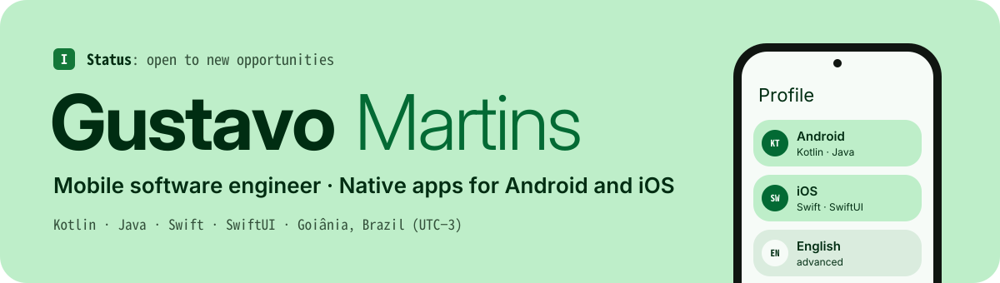

<picture>
  <source media="(prefers-color-scheme: dark)" srcset="./banner-dark.svg">
  
</picture>

### About me

I'm a mobile software engineer from Goiânia, Brazil. I've been building native apps since 2021, mostly for **Android** with Kotlin and Java, and also for **iOS** with Swift and SwiftUI.

- **Taqtile Brasil (2025–2026):** worked on the **Sephora Brazil** and **Sephora Mexico** native apps. I started on iOS with SwiftUI and became the main Android developer in late 2025.
- **LG lugar de gente (2021–2024):** built and maintained **Gen.te Mobile** and **Feedback Gen.te**. I led the migration of the Android apps to Clean Architecture and worked on the .NET APIs behind them.
- **Background:** B.Sc. in Software Engineering and a Law degree, both from UFG.

Most of my professional code lives in private client repositories. I'm now building open personal projects, and I'll pin them here as they ship.

### Stack

**Android:** Kotlin · Java · Clean Architecture · MVVM · Firebase 
**iOS:** Swift · SwiftUI · UIKit 
**Also:** C# / .NET · Node.js · TypeScript · Git · Claude Code

### Contact

I'm open to remote mobile roles, Android or iOS, in Brazil or abroad.

[Portfolio](https://ghfmartins.github.io) · [LinkedIn](https://www.linkedin.com/in/dev-gustavomartins) · gh.martins9@gmail.com
